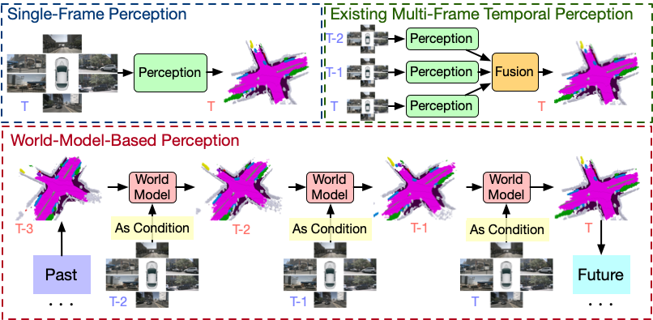
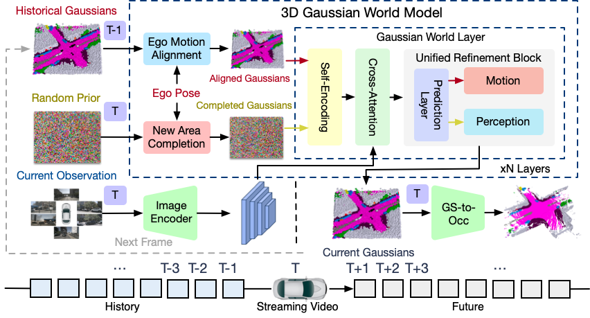

# GaussianWorld: Gaussian World Model for Streaming 3D Occupancy Prediction
### [Paper](https://arxiv.org/abs/2412.10373)

> GaussianWorld: Gaussian World Model for Streaming 3D Occupancy Prediction

> [Sicheng Zuo<sup>\*</sup>](https://scholar.google.com/citations?user=11kh6C4AAAAJ&hl=en&oi=ao), [Wenzhao Zheng<sup>\*</sup>](https://wzzheng.net/)$\dagger$,  [Yuanhui Huang](https://scholar.google.com/citations?hl=zh-CN&user=LKVgsk4AAAAJ), [Jie Zhou](https://scholar.google.com/citations?user=6a79aPwAAAAJ&hl=en&authuser=1), [Jiwen Lu](http://ivg.au.tsinghua.edu.cn/Jiwen_Lu/)

<sup>\*</sup> Equal contribution. $\dagger$ Project leader

GaussianWorld reformulates 3D occupancy prediction as a 4D occupancy forecasting problem conditioned on the current sensor input and propose a **Gaussian World Model** to exploit the scene evolution for perception.



## Overview
To exploit the scene evolution for perception, we reformulate the 3D occupancy prediction as a 4D occupancy forecasting problem conditioned on the current visual input.
We propose a Gaussian World Model (GaussianWorld) to explicitly exploit the scene evolution in the 3D Gaussian space and predict 3D occupancy in a streaming manner.
Our GaussianWorld demonstrates state-of-the-art performance compared to existing methods without introducing additional computation overhead.



## Getting Started

### Installation
Follow instructions [HERE](docs/installation.md) to prepare the environment.

### Data Preparation
1. Download nuScenes V1.0 full dataset data [HERE](https://www.nuscenes.org/download).

2. Download the occupancy annotations from SurroundOcc [HERE](https://github.com/weiyithu/SurroundOcc) and unzip it.

3. Download pkl files [HERE](https://cloud.tsinghua.edu.cn/d/095a624d621b4aa98cf9/).

4. Download the pretrained weights for the image backbone [HERE](https://cloud.tsinghua.edu.cn/f/00fea9c23eac448ea9f5/) and put it inside pretrain

**Folder structure**
```
GaussianWorld
├── ...
├── data/
│   ├── nuscenes/
│   │   ├── maps/
│   │   ├── samples/
│   │   ├── sweeps/
│   │   ├── v1.0-test/
|   |   ├── v1.0-trainval/
│   ├── surroundocc/
│   │   ├── samples/
│   │   |   ├── xxxxxxxx.pcd.bin.npy
│   │   |   ├── ...
│   ├── nuscenes_temporal_infos_train.pkl
│   ├── nuscenes_temporal_infos_val.pkl
├── pretrain/
│   ├── r101_dcn_fcos3d_pretrain.pth
```

### Inference
We provide the following checkpoints trained on the SurroundOcc dataset:

| Name  | Type | #Gaussians | mIoU | Config | Weight |
| :---: | :---: | :---: | :---: | :---: | :---: |
| GaussianFormer | Single-Frame | 25600 | 19.85 | [config](config/nusc_surroundocc_base_eval.py) | [weight](https://cloud.tsinghua.edu.cn/f/a749f8c59e554a46a596/) |
| GaussianWorld | Streaming | 25600  | 22.13 | [config](config/nusc_surroundocc_stream_eval.py) | [weight](https://cloud.tsinghua.edu.cn/f/4939dcc50b2a44c1b98d/) |

Evaluate the single-frame model GaussianFormer on the SurroundOcc validation set:
```bash
bash scripts/eval_base.sh config/nusc_surroundocc_base_eval.py out/ckpt_base.pth out/xxxx
```

Evaluate the streaming model GaussianWorld on the SurroundOcc validation set:
```bash
bash scripts/eval_stream.sh config/nusc_surroundocc_stream_eval.py out/ckpt_stream.pth out/xxxx
```

### Train

Train the single-frame model GaussianFormer on the SurroundOcc validation set:
```bash
bash scripts/train_base.sh config/nusc_surroundocc_base.py out/xxxx
```

Train the streaming model GaussianWorld on the SurroundOcc validation set:
```bash
bash scripts/train_stream.sh config/nusc_surroundocc_stream.py out/xxxx
```

### Visualize
Install packages for visualization according to the [documentation](docs/installation.md).

Visualize the single-frame model GaussianFormer on the SurroundOcc validation set:
```bash
bash scripts/vis_base.sh config/nusc_surroundocc_base_visualize.py out/ckpt_base.pth scene-0098 out/xxxx
```

Visualize the streaming model GaussianWorld on the SurroundOcc validation set:
```bash
bash scripts/vis_stream.sh config/nusc_surroundocc_stream_visualize.py out/ckpt_stream.pth scene-0098 out/xxxx
```

## Related Projects

Our work is inspired by these excellent open-sourced repos:
[TPVFormer](https://github.com/wzzheng/TPVFormer)
[PointOcc](https://github.com/wzzheng/PointOcc)
[SelfOcc](https://github.com/huang-yh/SelfOcc)
[GaussianFormer](https://github.com/huang-yh/GaussianFormer)
[SurroundOcc](https://github.com/weiyithu/SurroundOcc) 
[OccFormer](https://github.com/zhangyp15/OccFormer)
[BEVFormer](https://github.com/fundamentalvision/BEVFormer)

## Citation

If you find this project helpful, please consider citing the following paper:
```
@article{zuo2024gaussianworld,
    title={GaussianWorld: Gaussian World Model for Streaming 3D Occupancy Prediction},
    author={Zuo, Sicheng and Zheng, Wenzhao and Huang, Yuanhui and Zhou, Jie and Lu, Jiwen},
    journal={arXiv preprint arXiv:2412.10373},
    year={2024}
}